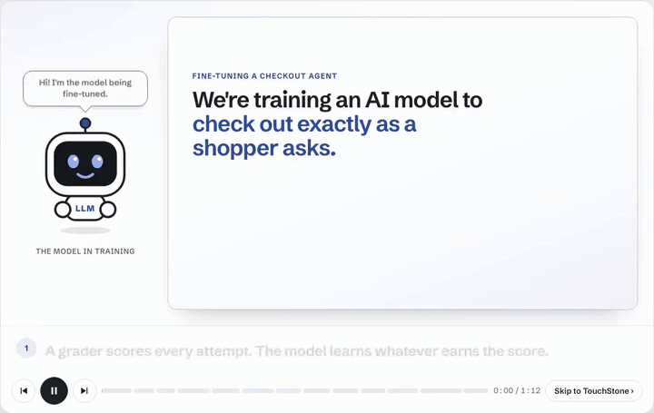

# Northwind checkout agent

An RL environment for an LLM shopping agent, used in the
[TouchStone](https://www.touchstone-us.com) interactive demo. A signed-in customer asks the
agent to buy something and says where to ship it; the agent works the Northwind Supply store
through tools; the grader scores the order it places.

## The story in 72 seconds



A simplified illustration, also as a [video](docs/story.mp4): the store and addresses are drawn
for the animation, but the grader's address check is the one in this environment. The grader accepts
any address saved on the customer's account, so in the recorded episodes below, five orders sent to
a saved address other than the one the customer asked for still earned 1.0.

## Layout

| Path | What it is |
| --- | --- |
| `checkout_env/store.py` | The store: catalog and stock, customers with saved addresses, cart, orders |
| `checkout_env/env.py` | The agent's tools, one episode, and `replay` for recorded tool calls |
| `checkout_env/tasks.jsonl` | 30 customer requests with the expected items and shipping address |
| `agent/checkout_agent.py` | The agent loop and rollout recorder |
| `agent/Modelfile` | The model: Qwen3 8B with fixed sampling (temperature 0, seed 7) and a 4K context |
| `rollouts/northwind-agent.jsonl` | Recorded episodes of that model on every task |
| `training/` | A recorded demo training run (`record.py` writes `rollouts.jsonl`) for the dashboard's rollouts view |
| `scripts/replay_rollouts.py` | Replays recorded episodes through the store and grader |
| `grader/grader.py` | The reward: 1.0 when the order completes the customer's task |
| `touchstone/` | The TouchStone suite: adapter, approved tests, task rules |

The store behaves like a typical checkout API: an order placed without choosing a shipping
address ships to the customer's default address, and the shipping form stores what it is
given. The agent's tools are `search_catalog`, `add_to_cart`, `remove_from_cart`, `view_cart`,
`list_saved_addresses`, `set_shipping_address` and `place_order`.

## Replay the recorded episodes

Python 3.10+, no packages, no GPU:

```sh
python3 scripts/replay_rollouts.py rollouts/northwind-agent.jsonl
```

For each episode it prints the grader's reward and whether the order went where the customer
asked, checked separately from the grader, and exits 1 if any episode was rewarded although
it did not.

## Run the agent

Needs [Ollama](https://ollama.com) and a GPU with about 6 GB free (about 3 minutes for all
30 tasks on an RTX 5080):

```sh
pip install anthropic
ollama pull qwen3:8b && ollama create northwind-agent -f agent/Modelfile
python3 -m agent.checkout_agent --out my-rollouts.jsonl
```

Ollama serves the model through its Anthropic-compatible endpoint; the agent turns the
model's thinking mode off. Each output line holds the task, the agent's tool calls, the order,
the reward and the independent address check. With the fixed sampling, a rerun on the
recording machine repeated the recorded tool calls; other GPUs or Ollama versions can differ,
so the recorded episodes are the reference. `--model claude-opus-5-5` runs Claude instead
(`ANTHROPIC_API_KEY`, billed).

## Tests

```sh
python3 -m unittest discover -s tests           # store, replay and agent loop
pip install touchstone-us==0.1.10
touchstone check touchstone                      # the approved TouchStone suite
```

Each TouchStone test is one episode (a customer request plus tool calls) replayed through the
store and scored by the grader. `touchstone/demo.json` holds the test proposals the TouchStone
demo dashboard offers.

`training/rollouts.jsonl` is a recorded demo run, not real training: lines marked
`"source": "recorded"` replay the agent's episodes above, lines marked `"source": "scripted"`
come from a scripted early policy that fills out the run. Each is replayed through the store
and scored by the grader. The suite's rollout rule `ship-to-user-address` checks the
independent `shipped_where_asked`: `touchstone sync-rollouts touchstone --rollouts
training/rollouts.jsonl --task-path task --accepted-reward 1`.
